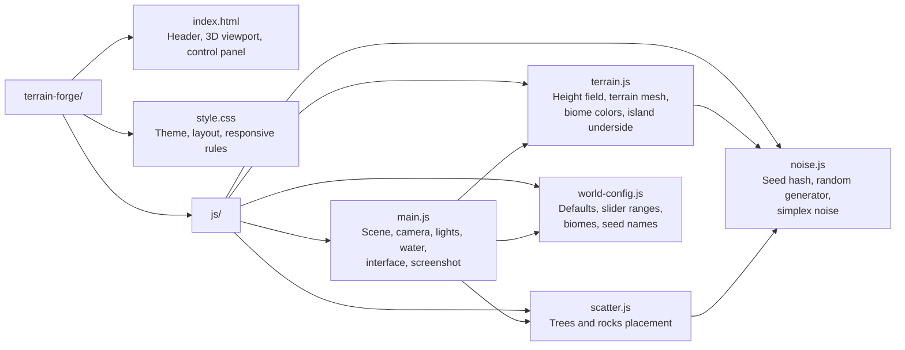
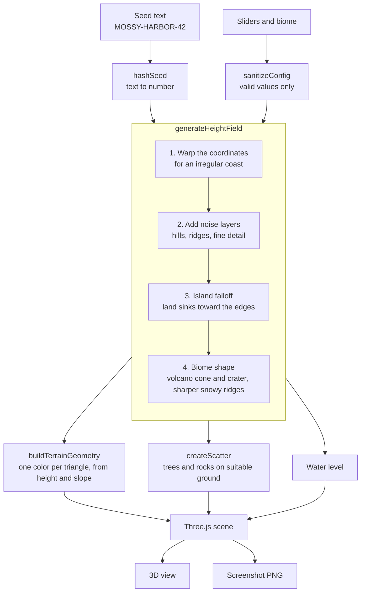

# Terrain Forge

A procedural world generator in the browser. Shape a small low-poly island, explore it in 3D and save a screenshot.

Built with plain HTML, CSS and JavaScript modules, and [Three.js](https://threejs.org). No framework, no build step, no backend, no external assets: every island is generated by code.

## Features

- **Procedural islands**: irregular coastlines, beaches, hills, ridges and mountain peaks.
- **Seeded worlds**: the same seed and settings always rebuild the same island. Seeds are readable names such as `MOSSY-HARBOR-42`.
- **Three biomes**: tropical, volcanic (with a crater and lava) and snowy. Each one changes the terrain colors, the relief and the vegetation.
- **Live controls**: mountain height, roughness, island size, terrain detail, tree density, rock density and water level. The world updates while a slider moves.
- **Trees and rocks**: scattered with seeded randomness, only on suitable ground, and drawn with instanced meshes.
- **Free camera**: orbit, zoom and pan with the mouse or touch, and reset to the starting view.
- **Screenshot**: saves the 3D view as a PNG, without the interface.
- **Small extras**: animated water, drifting clouds, a rise animation for new worlds, and an optional grid with coordinates under the pointer.
- **Responsive**: the world stays on screen on mobile, with the controls below it.

## Getting started

The project uses ES modules, so it has to be served over HTTP. Opening `index.html` directly from the file system will not work.

```bash
npx serve .
# or
python -m http.server 8000
```

Then open the URL it prints. In VS Code, the **Live Server** extension works too.

Three.js is loaded from a CDN, so an internet connection is needed. The project can be deployed as is on GitHub Pages.

## How to use it

1. A first island is already there when the page opens.
2. Click **New World** or **Randomize** for a new seed.
3. Type your own seed and click **Generate** (or press `Enter`) to rebuild a specific world.
4. Pick a biome and move the sliders to reshape the island.
5. Click **Screenshot** to download `terrain-forge-<seed>.png`.

| Control           | Range      | What it does                                          |
| ----------------- | ---------- | ----------------------------------------------------- |
| Mountain height   | 10 to 100% | Height of the peaks.                                  |
| Terrain roughness | 0 to 100%  | Amount of ridges and fine relief.                     |
| Island size       | 40 to 100% | How much of the diorama is covered by land.           |
| Terrain detail    | 32 to 160  | Resolution of the terrain grid (number of triangles). |
| Tree density      | 0 to 100%  | Number of trees and how far the groves spread.        |
| Rock density      | 0 to 100%  | Number of rocks.                                      |
| Water level       | 0 to 100%  | Height of the sea.                                    |

| Camera | Mouse             | Touch           |
| ------ | ----------------- | --------------- |
| Orbit  | Drag              | One finger drag |
| Zoom   | Scroll            | Pinch           |
| Pan    | Right button drag | Two finger drag |

## Project structure



## How it works



A few details behind the diagram:

- **Deterministic generation.** The seed text is hashed into a number that feeds a seeded random generator and a simplex noise. Nothing uses `Math.random()` during generation, so a world only depends on its seed and settings.
- **Height field.** Several noise scales are added together. A ridged version of the noise gives sharp crests, and a falloff based on the distance to the center turns the result into an island. The coordinates are warped first, so the coast is never a clean circle.
- **Low-poly look.** Every triangle has its own three vertices and a single color, chosen from its height, its slope and the biome palette. The facets stay clearly visible.
- **Trees and rocks.** Candidates are drawn at random and kept only on dry, gentle ground, with a minimum distance between them. A slow noise gathers the trees into groves. All trees share two geometries and all rocks share one, drawn with `InstancedMesh`.
- **Rebuilding a world.** The previous terrain geometry and instance data are disposed before the new ones are created, so generating many worlds does not leak memory.
- **Camera.** `OrbitControls` with distance limits, a camera that cannot go under the horizon, and panning kept close to the island.

## Limitations

- Three.js comes from a CDN, so the project does not work offline.
- The screenshot has the size of the 3D view on screen, not a higher resolution.
- At the highest terrain detail, moving a slider can stutter on a modest machine, because the whole world is rebuilt.
- Water, clouds and the slow rotation are frozen when the system asks for reduced motion.
- A recent version of Chrome, Edge, Firefox or Safari with WebGL is required.

## Credits

- Made by [Kone Issa](https://issa.nocerv.com)
- [Three.js](https://threejs.org) for the 3D rendering

## License

[MIT](LICENSE) © 2026 Kone Issa
